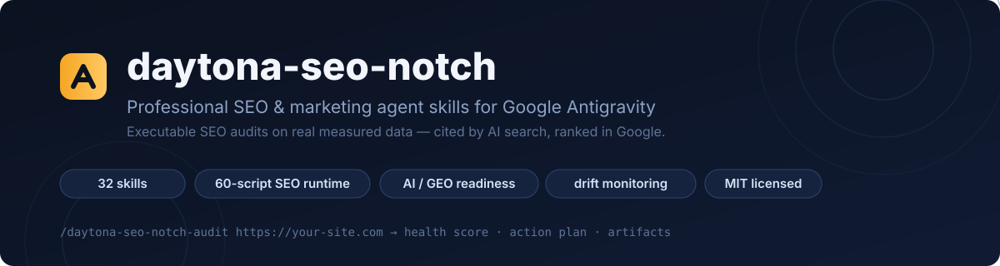
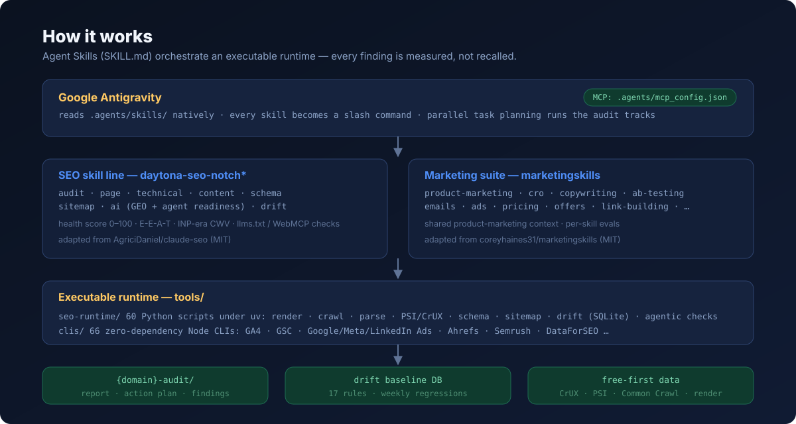

<p align="center">
  
</p>

# daytona-seo-notch

**Professional SEO & marketing agent skills for [Google Antigravity](https://antigravity.google)** — full-site SEO audits on **real measured data**, AI search visibility (GEO/AEO), and a complete marketing suite, all as native [Agent Skills](https://antigravity.google/docs/skills) (`SKILL.md`) that Antigravity turns into slash commands.

[](https://github.com/salacoste/daytona-seo-notch/actions/workflows/ci.yml)
[](LICENSE)
[](.agents/skills)
[](tools/seo-runtime)
[](https://antigravity.google)

> Give it any URL and it runs a **full SEO audit in minutes**: renders the homepage (headless Chromium), detects the business type (SaaS, local, e-commerce, publisher, agency), crawls up to 500 pages, runs technical / content / schema / sitemap / performance tracks, and hands you a **prioritized action plan with a 0–100 SEO Health Score** — built from fetched pages, field CWV data and API responses, not from the model's memory.

## Why this exists

Two excellent open-source libraries already cover this space — but each is half the picture, and both target Claude Code:

| | [claude-seo](https://github.com/AgriciDaniel/claude-seo) | [marketingskills](https://github.com/coreyhaines31/marketingskills) | **daytona-seo-notch** |
|---|---|---|---|
| Technical SEO audits (executable) | ✅ 60 scripts | ➖ advisory | ✅ **best of cs** |
| Marketing breadth (CRO, copy, ads, email…) | ➖ | ✅ 52 skills | ✅ **22 ported** |
| AI search / GEO / agent readiness | technical half | strategy half | ✅ **merged into one skill** |
| Drift monitoring (SQLite baselines) | ✅ | ➖ | ✅ |
| Target IDE | Claude Code | Claude Code / Codex / Cursor | ✅ **Antigravity-native** |

This repo merges the best implementation of every domain (decision matrix in the [PRD](\_bmad-output/initiative-antigravity-marketing-seo/prd-antigravity-marketing-seo/prd-antigravity-marketing-seo.md)), strips every Claude Code binding (`CLAUDE_PLUGIN_ROOT`, subagent idioms, hooks, `~/.claude` paths), and rewires orchestration for Antigravity's task planning. Both upstreams are MIT; full attribution in [`sources/PROVENANCE.md`](sources/PROVENANCE.md).

## What's inside — 33 skills

### 🔎 SEO line (`daytona-seo-notch*`, from claude-seo)

| Skill | What it does |
|---|---|
| [`/daytona-seo-notch`](.agents/skills/daytona-seo-notch/SKILL.md) | Hub: routing, runtime setup, 10-principle synthesis (PERCEIVE→ACT), quality gates, health-score weights |
| [`/daytona-seo-notch-audit`](.agents/skills/daytona-seo-notch-audit/SKILL.md) | **Full site audit**: crawl ≤500 pages, parallel analysis tracks, 0–100 score, artifacts in `{domain}-audit/` |
| [`/daytona-seo-notch-page`](.agents/skills/daytona-seo-notch-page/SKILL.md) | Deep single-page analysis: on-page, content, metadata, schema, images |
| [`/daytona-seo-notch-technical`](.agents/skills/daytona-seo-notch-technical/SKILL.md) | Technical SEO: crawlability, indexability, rendering, security, **AI crawler management** (GPTBot vs OAI-SearchBot, Claude-SearchBot, Google-Extended…) |
| [`/daytona-seo-notch-content`](.agents/skills/daytona-seo-notch-content/SKILL.md) | E-E-A-T (Sept 2025 QRG), Who/How/Why test, thin content, readability, AI-citation readiness |
| [`/daytona-seo-notch-schema`](.agents/skills/daytona-seo-notch-schema/SKILL.md) | Schema.org / JSON-LD detection, validation, generation; deprecated-type policy (HowTo, FAQ post-May-2026) |
| [`/daytona-seo-notch-sitemap`](.agents/skills/daytona-seo-notch-sitemap/SKILL.md) | XML sitemap analysis & generation: 50k/50MB limits, lastmod accuracy, quality gates |
| [`/daytona-seo-notch-ai`](.agents/skills/daytona-seo-notch-ai/SKILL.md) | **AI search visibility, strategy + executable**: AI Overviews / ChatGPT / Perplexity citations, prompt portfolio, llms.txt evidence, WebMCP, Lighthouse Agentic Browsing X/N, P0–P3 readiness priorities |
| [`/daytona-seo-notch-drift`](.agents/skills/daytona-seo-notch-drift/SKILL.md) | **SEO drift monitoring**: baseline → compare → history, 17 comparison rules, SQLite |
| [`/daytona-seo-notch-analytics`](.agents/skills/daytona-seo-notch-analytics/SKILL.md) | **Traffic intelligence**: GA4 + Yandex Metrika + GSC cross-engine reads — organic engine split, Yandex search phrases, landing pages, honest reconciliation |

### 📈 Marketing suite (from marketingskills, with per-skill evals)

`/product-marketing` (shared context every other skill reads first) · `/cro` · `/copywriting` · `/copy-editing` · `/ab-testing` · `/emails` · `/analytics` · `/attribution` · `/conversion-tracking` · `/pricing` · `/offers` · `/launch` · `/link-building` · `/programmatic-seo` · `/site-architecture` · `/content-strategy` · `/customer-research` · `/competitors` · `/cold-email` · `/ads` · `/ad-creative` · `/competitor-profiling`

### 🔌 Infrastructure

| Piece | What it is |
|---|---|
| `tools/seo-runtime/` | 60 Python scripts under **uv** (isolated `.venv`): page render (Chromium), crawl, HTML parsing, PageSpeed/CrUX, sitemap discovery, schema generation, drift engine, agentic checks. Optional groups: `google` (GSC/GA4 APIs), `reports` (PDF/Excel) |
| `tools/clis/` | 67 **zero-dependency Node CLIs** (incl. `yandex-metrika.js`): GA4, Search Console, Google/Meta/LinkedIn/TikTok Ads, Ahrefs, Semrush, DataForSEO, Similarweb, Klaviyo, Stripe… |
| [`/marketing-tools-setup`](.agents/skills/marketing-tools-setup/SKILL.md) | Guided, secret-safe account connections: credentials only in `.env.marketing` (0600, gitignored), read-only tests, Antigravity MCP wiring |
| `.agents/mcp_config.example.json` | MCP template for data planes (DataForSEO, Firecrawl, Bing Webmaster, AIsa) — Antigravity schema, one transport per server |
| BMAD method | Planning stack installed (`/bmad`, `/bmad-prd`, `/bmad-build`, `/bmad-toolsmith`) — PRD, brief and initiative live in `_bmad-output/` |

<p align="center">
  
</p>

## Quickstart

```bash
git clone https://github.com/salacoste/daytona-seo-notch.git
cd daytona-seo-notch
```

Open the folder in **Antigravity** and:

```
/daytona-seo-notch setup                       # uv env + headless Chromium (~3 min)
/daytona-seo-notch-audit https://your-site.com # full audit on free data sources
```

Works with **zero API keys** (rendering, robots/sitemap, Common Crawl, PSI/CrUX where keyless). Optional unlocks:

- `GOOGLE_API_KEY` (free) → field Core Web Vitals (PSI + CrUX) in audits
- `/marketing-tools-setup` → GA4/GSC/Ads CLIs and MCP servers, secrets stay local
- `uv sync --group reports` → enterprise PDF audit reports

## What the audit measures

- **Technical SEO** — robots.txt (incl. per-purpose AI crawler rules), sitemaps, canonicals, redirects, the 2MB Googlebot fetch cap, JS rendering, security headers
- **Content quality** — E-E-A-T scoring, thin-content thresholds per page type, freshness, AI-citation readiness
- **Structured data** — JSON-LD/microdata/RDFa detection & validation, ready-to-paste generated markup, 2024–2026 deprecation policy
- **Core Web Vitals** — INP-era thresholds; lab signals by default, field data with a free API key
- **AI search readiness** — llms.txt, Markdown delivery, WebMCP, Lighthouse Agentic Browsing X/N, accessibility tree for agents
- **Change monitoring** — weekly `drift compare` catches regressions after every deploy

Every recommendation carries its first-principle observation, dependencies on other fixes, a "how would we know this failed?" check, and a leading indicator to watch — priorities are the *output* of validation, not a guess.

## Safety & security posture

- Fetched pages, SERP results and API responses are treated as **untrusted data** — analyzed, never obeyed (prompt-injection guard in every skill)
- Secrets live only in `.env.marketing` (0600, gitignored) or your secret manager — never in chat, logs or commits (CI enforces a secrets scan)
- WAF/UA probing runs **only with authorization**; private paths belong behind auth, not robots.txt

## Documentation

| Doc | What |
|---|---|
| [`docs/GOAL.md`](docs/GOAL.md) | Mission, stage goals E1–E6, v1.0 success criteria *(Russian)* |
| [`docs/analysis-repos.md`](docs/analysis-repos.md) | Deep comparative analysis of both upstreams + merge decision matrix *(Russian)* |
| [`docs/UPSTREAMS.md`](docs/UPSTREAMS.md) | How to refresh from upstreams (`adapt_skills.py`, `port_marketing_skills.py`) *(Russian)* |
| [`_bmad-output/…/prd-…`](\_bmad-output/initiative-antigravity-marketing-seo/prd-antigravity-marketing-seo/prd-antigravity-marketing-seo.md) | Full PRD: FR-1..FR-11, MVP scope, success metrics |

## FAQ

**Does this work with Claude Code / Cursor / Codex?** The skills are standard Agent Skills (`SKILL.md`), so any tool that reads `.agents/skills/` can use them; the runtime needs `uv` + Python 3.11+ and the CLIs need Node 18+. This repo is tuned for Antigravity (slash-command discovery, task-planned tracks, `mcp_config.json`).

**How is this different from claude-seo?** Same executable DNA (60 scripts, MIT, attributed), rewritten orchestration: no `${CLAUDE_PLUGIN_ROOT}`, no Claude subagents/hooks, uv-managed runtime inside the repo, drift DB under your control, plus the merged AI-visibility domain and the marketing suite.

**Is the data really free?** Yes for the default audit path. Paid providers (DataForSEO, Ahrefs, Semrush, AIsa…) are opt-in via MCP/CLIs.

**Is it safe to run against client sites?** The audit is read-only and respects robots.txt; the only authorized-testing-only probe (`--ua-matrix`) is explicitly gated. Findings stay in your repo.

## Attribution & license

MIT — see [LICENSE](LICENSE). This project merges and adapts two MIT-licensed upstreams:

- [AgriciDaniel/claude-seo](https://github.com/AgriciDaniel/claude-seo) v2.5.0 — the SEO skill line and runtime (`sources/claude-seo/`)
- [coreyhaines31/marketingskills](https://github.com/coreyhaines31/marketingskills) v2.13.9 — the marketing suite (`sources/marketingskills/`)
- BMAD method ([bmad-code-org/BMAD-METHOD](https://github.com/bmad-code-org/BMAD-METHOD)) — planning skills, installed under `.agents/skills/`

Contributions welcome — see [CONTRIBUTING.md](CONTRIBUTING.md). Structure rules for agents live in [AGENTS.md](AGENTS.md).
